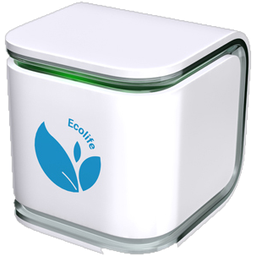

# EcoLife for Home Assistant



Unofficial Home Assistant integration for **EcoLife** air quality sensors (the ones used with the
*EcoLife Healthy Breathing* Android app). It reads sensor values from the EcoLife cloud.

## Features

- One **hub** (config entry) per EcoLife account. You set it up with your email, password and polling interval.
- When it starts, the hub logs in (`User/login`) and lists your measure points (`MeasurePoint/userSearch`).
  It then calls the same endpoint again at the interval you chose (10 s to 1 h).
- One HA device per measure point. Like the app's *My devices* list, this includes devices you
  *observe* as well as the ones you own.
- Sensors for every measure type the cloud reports:

  | EcoLife type    | Entity                  | Unit   |
  |-----------------|-------------------------|--------|
  | `PM25`          | PM2.5                   | µg/m³  |
  | `PM10`          | PM10                    | µg/m³  |
  | `TEMP`          | Temperature             | °C     |
  | `HUMIDITY`      | Humidity                | %      |
  | `PRESSURE`      | Atmospheric pressure    | hPa    |
  | `VOC`           | VOC                     | EcoLife index (`chwc`) |
  | `CONTAMINATION` | Pollution level         | % of norm |
  | `LIGHT`         | Illuminance             | lx     |
  | `range`         | Air quality (`verylow`, `low`, …) | – |
  | `lastUpdate`    | Last update (diagnostic) | timestamp |

  Each measurement sensor also has `norm` and `percent_of_norm` attributes, the same values the app shows.
  If a measure type isn't in this table, it gets a generic sensor.
- If the password changes, HA asks you to re-authenticate. You can change the polling interval
  under **Configure → Polling interval** and the password under **Reconfigure**.
- **Deleting a device in Home Assistant only hides it.** The integration never calls the EcoLife
  `removeDevice` endpoint, so the sensor stays registered on your account and in the mobile app.
  Its id is remembered as hidden, and HA skips it when polling and when restarting.
  To bring hidden devices back, open the hub and choose **Configure → Refresh device list**.
  This clears the hidden list and reloads the device list from the cloud.
- Bundled icon. `brand/icon.png` is the integration, hub and device icon, served locally by HA's brands API
  (tested on 2026.10; older versions show a placeholder).
- Diagnostics download, with credentials, location and IDs redacted.

## Installation

### HACS (custom repository)
1. HACS → ⋮ → *Custom repositories* → add this repository's URL, category **Integration**.
2. Install **EcoLife** and restart Home Assistant.

### Manual
Copy `custom_components/ecolife` into `<config>/custom_components/` and restart Home Assistant.

Then go to **Settings → Devices & services → Add integration → EcoLife**.

Requires Home Assistant 2025.8 or newer.

## Notes

- Credentials are kept in the config entry, the standard HA mechanism. They're stored in
  `<config>/.storage/core.config_entries`, which only the HA user can read, and they never appear in logs or diagnostics.
- Logging in from HA doesn't log out the mobile app. The cloud returns the same token for every session.

## Development

```bash
pip install pytest-homeassistant-custom-component
pytest
```
